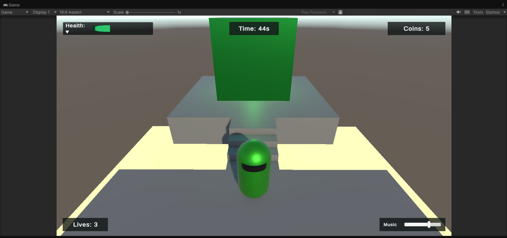
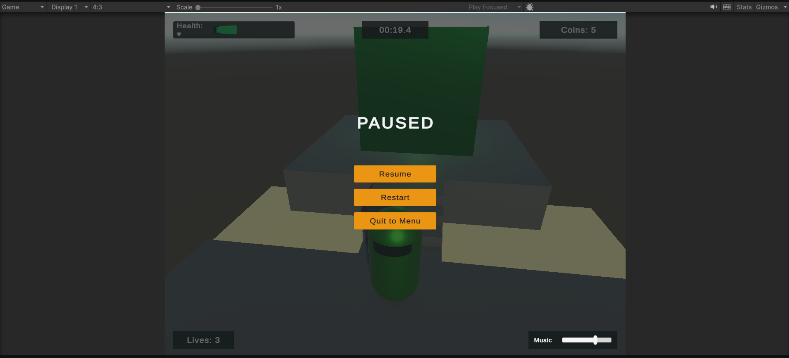
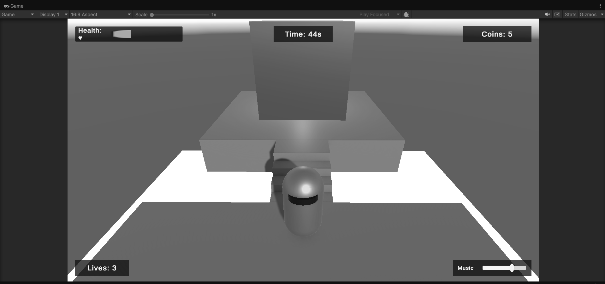
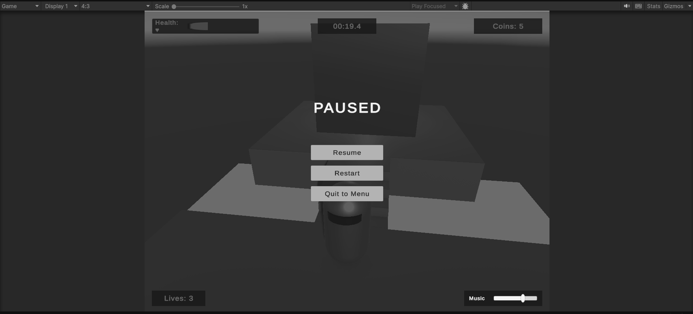

# CS464 Assignment 04 - Mustafa Fawwaz - BSSE23036

**Video Link:** https://drive.google.com/file/d/1DGmvoAFLUfPgZ7F4WRnxVEEqLKfVXA13/view?usp=sharing

## Settings

| Part | Setting | Value | Why |
|---|---|---|---|
| A | Harmony - base hue | Split-Complementary - `196°`| Separates cool HUD panels from warm amber buttons and crimson hazard/lag cues across varied level geometry. |
| A | Dark - mid - light | `#121A1D` - `#2ECC71` - `#F0F5F7` | Deep slate panel backing (`#121A1D`) anchors bright emerald health (`#2ECC71`) and crisp off-white text (`#F0F5F7`). |
| A | Accents | `#F39C12` - `#A3E4D7` | Warm amber (`#F39C12`) highlights interactive buttons; mint (`#A3E4D7`) marks active keyboard selection focus. |
| A | HUD text (`#F0F5F7`) on HUD panel (`#121A1D`) | `16.1 : 1` | Exceeds WCAG AAA (`>= 4.5:1`) for small timer, coin, heart, and lives readouts. |
| A | Button label (`#121A1D`) on Action button (`#F39C12`) | `7.8 : 1` | Exceeds WCAG AAA (`>= 4.5:1`) and stays distinct in grayscale. |
| B | Music - SFX groups, as mixed | `-4.0 dB` - `0.0 dB` | Keeps looping background music slightly underneath combat, pickup, and UI feedback cues. |
| B | Slider at 1 - 0.5 - 0.0001 | `0.0 dB` - `-6.0 dB` - `-80.0 dB` | Logarithmic conversion (`Mathf.Log10(v) * 20f`) maps linear slider travel to perceptual decibels without `log(0)` errors. |
| C | Enemy patrol hum (`engineCircular_000`), in `Level01`–`Level05` | `Logarithmic` - Min `2m` - Max `18m` | Models realistic distance falloff and subtle Doppler shift as guards patrol near or away from the player. |
| C | Goal / hazard beacon (`forceField_000`), in `Level01`–`Level05` | `Linear` - Min `1.5m` - Max `15m` | Provides a predictable spatial audio landmark that cuts off cleanly outside the beacon's `15m` radius. |
| C | AudioListener | On the player (`ListenerOnPlayer.cs`) | Ensures stereo panning and 3D attenuation match the character's position rather than the orbiting camera. |
| D | `UnlockedLevel` | `int` - default `1` | Keeps `Level01` playable on a fresh save while locking `Level02`–`Level05` until earned. |
| D | `BestTime_Level_1` … `BestTime_Level_5` | `float` - default `-1f` (`< 0f` check) | Distinguishes unplayed levels (`Best: --`) from valid clear times (`Best: XX.Xs`) before overwriting records. |
| D | `MusicVolume` | `float` - default `1` | Restores full normalized music volume (`0 dB`) on first launch before the player adjusts the slider. |

## Answers

1. **What `Time.timeScale = 0` stops in my game, and what it doesn't:**  
   Setting `Time.timeScale = 0` freezes `Time.deltaTime`-scaled movement/timers, `FixedUpdate()` Rigidbody physics, and standard `WaitForSeconds` coroutines. It does **not** stop `Update()` input polling (allowing `Esc` to unpause), `Time.unscaledDeltaTime` (used by `LevelLoader` fade transitions), UI `EventSystem` navigation, or `AudioSource` playback—which is why `PauseMenu` explicitly toggles `AudioListener.pause = true`.

2. **What survives a LoadScene in my game, and how:**  
   `SfxPlayer`, `MusicPlayer`, and `LevelLoader` survive scene loads via `DontDestroyOnLoad(gameObject)` paired with a singleton `Instance` check that destroys duplicates when re-entering scenes that also hold those prefabs. In addition, `GameManager.currentLives` persists across automatic death restarts as a `static` field, and `SaveData` (`UnlockedLevel`, `BestTime_Level_1`–`5`, and `MusicVolume`) persists across sessions on disk via `PlayerPrefs`.

3. **Why every PlayerPrefs read in my game has a default:**  
   On a first launch or immediately after clicking **Reset Progress**, none of the keys exist in `PlayerPrefs`. Supplying explicit defaults (`1` for `UnlockedLevel`, `-1f` for best times, and `1f` for `MusicVolume`) prevents zero-initialized fallback bugs—such as locking `Level01`, treating `0.0s` as an unbeatable best time, or starting the music slider at `-80 dB` (silent).

4. **An exception a forgotten unsubscribe would throw, and why mine can't:**  
   A forgotten unsubscribe throws a `MissingReferenceException` (*"The object of type '...' has been destroyed but you are still trying to access it"*) if `Health.Damaged` fires after a level reload or object destruction and attempts to invoke a destroyed listener. Mine cannot throw this exception because every listener (`UIManager`, `HitFeedbackListener`, and `CameraShakeListener`) subscribes with `+=` in `OnEnable()` and symmetrically unsubscribes with `-=` in `OnDisable()`.

## Credits

- **Sound Effects (`Digital Audio`, `Interface Sounds`, `Sci-Fi Sounds`, `Impact Sounds`)** - Kenney - https://kenney.nl/assets - CC0 1.0 (Public Domain)
- **Basic Platformer music** - Vircon32 (Carra), composed by Sebastian F. (`@fraynvgm`) - https://opengameart.org - CC-BY 4.0
- **Liberation Sans SDF (TextMeshPro Default Font)** - Unity Technologies / Red Hat - https://unity.com - SIL Open Font License 1.1